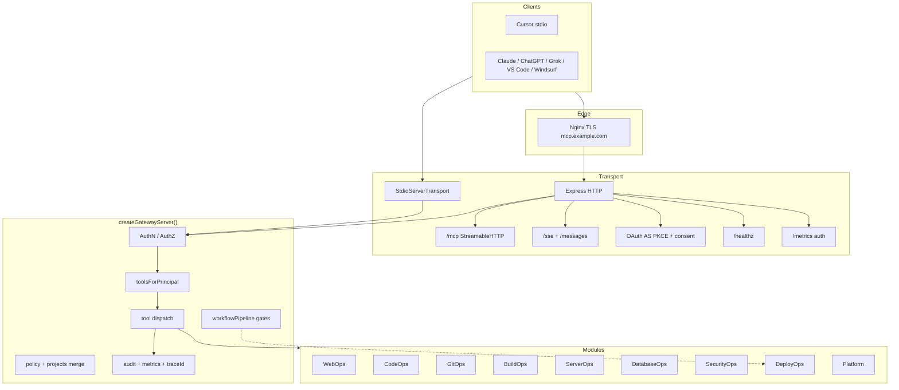

# MCP Existing System Audit — `global-server-mcp`

**Audit date:** 2026-11-12 (updated post Phases 9–14)  
**Prior audits:** Same-day pre–Phase-1; post–Phase-8 (superseded)  
**Scope:** Local workspace source + non-secret config only  
**Constraints honored:** No production VPS/DB deploys; no secret/env value disclosure; `allow_production_dispatch` remains false  
**Method:** Source verification against `src/`, `config/`, `deploy/`, `docs/`, packaging, fixtures; `npm test` → **125 pass**. Docs marked **Documented Only** / **Not Verified** unless code confirms. Live client/VPS/GitHub E2E **not** claimed.

**Status legend**

| Status | Meaning |
|---|---|
| **Implemented** | Present in source and wired into runtime |
| **Partially Implemented** | Code exists but incomplete, gated off, or uncertified for prod |
| **Documented Only** | Mentioned in docs/roadmap; no runtime impl |
| **Not Implemented** | Absent from source |
| **Not Verified** | Plausible from code/docs; live E2E not confirmed in this audit |
| **Configuration Required** | Implemented; needs operator secrets/hosts/certs |

---

## 1. Executive Summary

`global-server-mcp` (v0.1.0) is a **single central policy-gated MCP platform**. Gateway spine retained through Phases 1–14.

| Module / area | Status |
|---|---|
| WebOps (HTTP + Playwright) | Implemented |
| CodeOps (allowlisted FS) | Implemented |
| GitOps (GitHub App API) | Implemented (live: Configuration Required) |
| BuildOps (curated sandboxed tasks) | Implemented |
| ServerOps (SSH/mock VPS) | Implemented (live: Configuration Required) |
| DatabaseOps (PG/MySQL first) | Implemented (live: Configuration Required) |
| SecurityOps (defensive scans) | Implemented (CLI absent → mock) |
| DeployOps (staging + human-gated prod request) | Implemented; prod dispatch **off** |
| Platform (registry, modules, metrics, workflow gates) | Implemented |
| Docker / non-root packaging | Implemented (ADR 013) |
| GitHub Actions CI | Implemented (workflow present; remote run Not Verified — no `.git` at prior checkpoint) |
| Nginx TLS edge template | Implemented (`mcp.example.com` placeholder) |
| Client live certification | Partially Implemented — matrix = **protocol** until E2E |

**Transports:** stdio + Streamable HTTP `/mcp` + legacy SSE.  
**Security spine:** default-deny YAML, capability classes, SSRF, rate limit, kill switch, audit/metrics JSONL (+ traceId), redaction, principal-bound sessions, filtered tool discovery, OAuth operator consent, durable hashed OAuth store.

**Verdict:** Do **not** rebuild. Code+packaging ready for **staging management-VPS bring-up**. **Not** production-certified for live control plane until `MCP_LIVE_TEST_CHECKLIST.md` signed. Operator must wire keys, known_hosts, TLS domain, GitHub App.

| Area | Status |
|---|---|
| Central MCP gateway | Implemented |
| Stdio + Streamable HTTP + SSE | Implemented |
| API-key AuthN (fail-closed) | Implemented |
| OAuth PKCE + operator consent | Implemented |
| YAML default-deny + project scope | Implemented |
| Tool discovery filtered by principal | Implemented |
| SSRF / rate limit / audit / redact / metrics | Implemented |
| Git / Build / Server / DB / Security / Deploy | Implemented (gated) |
| Universal project registry + templates | Implemented |
| Workflow plan gates (`workflowPipeline`) | Implemented (unit-verified) |
| Docker + compose (non-root, cap_drop) | Implemented |
| CI workflow (typecheck/test/build/secrets/docker) | Implemented |
| Nginx / systemd / logrotate / backup scripts | Implemented (templates) |
| MCP resources / prompts | Not Implemented |
| Unrestricted shell / root SSH / free-form prod SQL | Not Implemented (by design) |
| Multi-tenant hard process isolation | Not Implemented (documented non-goal) |
| Production deploy auto-dispatch | Not Implemented (policy default deny) |
| External IdP / mTLS | Not Implemented |
| Automated tests | Implemented (**125** unit/fixture) |
| Production readiness | Partially Implemented — packaging + docs; live host Not Verified |

---

## 2. Existing Architecture

### 2.1 Project identity

| Item | Evidence |
|---|---|
| Name | `global-server-mcp` — `package.json` |
| Version | `0.1.0` |
| Purpose | Universal MCP platform (WebOps→DeployOps) + prod packaging — ADR 012–013 |
| Runtime | Node.js `>=20`, TypeScript, ESM |
| MCP SDK | `@modelcontextprotocol/sdk` |
| Entry | `src/index.ts` → stdio or HTTP via `MCP_TRANSPORT` |

### 2.2 Architectural pattern

**One central MCP gateway** + thin adapters + config registries + optional container/edge:

- Gateway: AuthN/AuthZ, policy, SSRF, rate limit, audit, metrics/traceId, retry, dispatch (`src/gateway.ts`)
- Adapters: `src/adapters/{http,browser,code,git,build,server,db,security,deploy}`
- Platform: `src/platform/` (registry, modules, observability, retry, **workflowPipeline**)
- Policy merge: `loadPolicy()` → `mergeProjectsIntoPolicy()`
- Host packaging: `Dockerfile`, `docker-compose.yml`, `deploy/nginx|systemd|logrotate|scripts`

### 2.3 Dependencies (runtime)

`@modelcontextprotocol/sdk`, `express`, `playwright`, `yaml`, `@octokit/auth-app`, `@octokit/rest`, `pg`, `mysql2`, `zod`

### 2.4 Mermaid — architecture (current)



### 2.5 Configuration

| Mechanism | Status |
|---|---|
| `.env` / `.env.example` | Implemented |
| `config/policy.yaml` + env profiles examples | Implemented |
| `config/projects.yaml` + stack-profiles | Implemented |
| Module registries (servers/db/security/deploy) | Implemented |
| Onboarding templates (`config/templates/*`) | Implemented |
| Secrets in tool args | Forbidden by design |

### 2.6 Documentation

| Doc | Role |
|---|---|
| `README.md` / `AGENTS.md` / `progress.md` | Entry + rules + state |
| `MCP_EXISTING_SYSTEM_AUDIT.md` | This audit |
| `PHASES_AUDIT.md` / `PHASE2`–`PHASE8_*` / `PHASE9_14_*` | Phase evidence |
| `MCP_PRODUCTION_READINESS.md` | Scorecard |
| `MCP_CLIENT_COMPATIBILITY_MATRIX.md` | Client honesty |
| `MCP_VPS_ONBOARDING_GUIDE.md` | ServerOps bring-up |
| `MCP_NEXTJS_STRAPI_INTEGRATION.md` | FE/BE onboard |
| `MCP_SECURITY_REVIEW.md` | Security review |
| `MCP_LIVE_TEST_CHECKLIST.md` | Operator E2E gates |
| `docs/**` + ADRs 001–013 | Architecture / modules |

### 2.7 Deployment / environments (gateway host)

| Concern | Status |
|---|---|
| Local stdio / HTTP | Implemented |
| Docker non-root + healthcheck | Implemented |
| compose hardening (read-only, cap_drop) | Implemented |
| systemd unit template | Implemented |
| Nginx HTTPS template | Implemented (placeholder domain) |
| CI workflow in-repo | Implemented |
| CI green on remote | Not Verified |
| Live management VPS deploy | Not Implemented / Blocked (operator) |
| TLS real certs | Configuration Required |
| Target app prod dispatch | Not Implemented (deny by default) |

### 2.8 Limitations

1. Single Node process; principal isolation ≠ hard multi-tenant VM isolation  
2. MCP tools only — no resources/prompts  
3. `roles` field unused (capabilities + flags used)  
4. Docker/PM2/Vercel deploy providers partially stubbed  
5. Mongo/SQLite/Redis DB drivers not implemented  
6. Scanner CLIs optional → mock findings  
7. Clients mostly **protocol**; Next/Strapi stacks **supported** not certified  
8. In-process locks not shared across gateway replicas  
9. Workspace may lack `.git` — CI unproven on remote until pushed  

---

## 3. MCP Request Lifecycle

### 3.1 Stdio / HTTP

Unchanged spine: AuthN → rate limit → `toolsForPrincipal` / `requireCap` → host/SSRF/project gates → adapter → redact → audit + metrics. HTTP: Host allowlist, OAuth when `MCP_PUBLIC_BASE_URL` set, `/healthz` public, `/mcp|/sse|/messages|/metrics` auth. SIGTERM/SIGINT graceful close + session drain.

### 3.2 Concurrency / isolation

HTTP sessions capped; browser sessions principal-bound; build workspaces per principal; deploy/server/db locks in-process; multi-replica shared locks Documented Only.

---

## 4. Project Structure (current)

```
global-server-mcp/
├── AGENTS.md / README.md / progress.md
├── MCP_*.md / PHASE*.md / PHASES_AUDIT.md
├── Dockerfile / docker-compose.yml / .dockerignore
├── .github/workflows/ci.yml
├── package.json / package-lock.json
├── config/
│   ├── policy.yaml (+ env examples)
│   ├── projects.yaml / stack-profiles.yaml
│   ├── servers|databases|security|deployments.yaml
│   └── templates/ (nextjs, strapi, vps, database-readonly)
├── deploy/
│   ├── nginx/mcp.example.com.conf
│   ├── systemd/global-server-mcp.service
│   ├── logrotate/global-server-mcp
│   └── scripts/backup-gateway.sh | restore-gateway.sh
├── docs/ (+ decisions 001–013, clients, onboarding)
├── fixtures/
├── src/
│   ├── gateway.ts / index.ts / config.ts / types.ts
│   ├── auth/ audit/ policy/ security/ session/ transport/
│   ├── tools/definitions.ts
│   ├── adapters/*
│   └── platform/ (+ workflowPipeline.ts)
└── logs/ data/ (runtime)
```

---

## 5. Module Inventory

### 5.1–5.8 Ops modules — Implemented (gated)

Unchanged from Phase 8 audit: WebOps, CodeOps, GitOps, BuildOps, ServerOps, DatabaseOps, SecurityOps, DeployOps tool surfaces and gates. Live wiring = **Configuration Required**. Prod migrate/scan/dispatch flags default deny.

### 5.9 Platform — Implemented

| Tool / piece | Status |
|---|---|
| `platform.info` / `platform.projects` / `platform.metrics` | Implemented |
| Project registry merge / module catalog / stack profiles | Implemented |
| Observability + safe-read retry + revocation list | Implemented |
| `workflowPipeline` staging/prod gate validation | Implemented (unit) |

### 5.10 Meta — Implemented

`policy.explain` (read), `audit.tail` (admin)

---

## 6. AuthN / AuthZ / Governance

| Control | Status |
|---|---|
| API key fail-closed | Implemented |
| OAuth PKCE + operator consent | Implemented |
| Durable hashed OAuth store | Implemented |
| Capability classes + filtered tools | Implemented |
| Project-scoped hosts/paths/repos/servers/dbs | Implemented |
| Browser session principal bind | Implemented |
| Kill switch / rate limit / revoke list | Implemented |
| Human approvals (git/build/server/db/deploy) | Implemented |
| AI self-approve prod deploy | Denied (unit-verified) |
| Roles field enforcement | Not Implemented |
| External IdP / mTLS | Not Implemented |

---

## 7. Packaging, CI, DR (Phases 9–14)

| Item | Status | Evidence |
|---|---|---|
| Multi-stage Dockerfile, user 10001 | Implemented | `Dockerfile` |
| compose read-only + cap_drop | Implemented | `docker-compose.yml` |
| `npm run ci` / `start:prod` / `docker:*` | Implemented | `package.json` |
| GHA: typecheck, test, build, secret patterns, docker smoke | Implemented | `.github/workflows/ci.yml` |
| Nginx streaming + HTTPS template | Implemented | `deploy/nginx/mcp.example.com.conf` |
| systemd hardening unit | Implemented | `deploy/systemd/` |
| logrotate + backup/restore scripts | Implemented | `deploy/logrotate/`, `deploy/scripts/` |
| Graceful SIGTERM | Implemented | `httpServer.ts`, `gateway.ts` |
| Remote CI execution | Not Verified | Needs git remote |
| Live gateway on management VPS | Blocked | Operator |

---

## 8. Testing

| Suite | Status |
|---|---|
| Auth / OAuth / SSRF / sessions / modules 2–8 | Implemented |
| Platform + **workflowPipeline** | Implemented |
| Optional live PG/MySQL | Partially Implemented (env-gated) |
| Live Cursor/Grok/Claude/VPS/GitHub E2E | Not Verified / OVR |
| **Observed this audit:** `npm test` → **125 pass / 0 fail** | Verified (local) |

---

## 9. Client & stack honesty

| Integration | Status |
|---|---|
| Cursor / Grok / Claude Desktop / Code / ChatGPT / VS Code / Windsurf | **protocol** — see `MCP_CLIENT_COMPATIBILITY_MATRIX.md` |
| Next.js / Strapi stack profiles | **supported** (not certified) |
| PostgreSQL / MySQL adapters | Implemented (mock CI; live optional) |
| Semgrep / Trivy / Gitleaks / OSV | Partially Implemented (mock if missing) |
| Production deploy dispatch | Not Implemented by default |
| MongoDB / Redis / SQLite | Not Implemented (planned) |

---

## 10. Security findings (refresh)

### Strengths

Default-deny; no unrestricted shell; env secrets; human approvals; prod flags off; OAuth consent; non-root container; edge TLS template; CI secret pattern scan; workflow prod self-approve blocked in tests.

### Residual risks / gaps

1. Live AuthZ/client paths Not Verified  
2. `/metrics` needs edge ACL + AuthN (documented)  
3. Single-process locks / multi-replica  
4. Mock scanners ≠ confirmed vulns  
5. Placeholder domain must be replaced  
6. Mis-granting admin + `oauth_allowed` to remote clients = high ops risk  
7. Management VPS not deployed this audit  

---

## 11. Comparison vs post–Phase-8 audit

| Prior claim | Now |
|---|---|
| CI / Docker packaging Not Implemented | **False** — Implemented (ADR 013) |
| 120 tests | **125** (+ workflowPipeline) |
| No Nginx/systemd/backup scripts | **False** — templates under `deploy/` |
| No formal client matrix / live checklist | **False** — `MCP_CLIENT_*` + `MCP_LIVE_TEST_CHECKLIST.md` |
| No Next/Strapi/VPS/DB templates | **False** — `config/templates/` |
| Production readiness Partial | Still Partial — packaging done; live certify open |
| Prod dispatch off | **Unchanged** (correct) |

---

## 12. Recommendations (priority)

1. Init/push git remote; confirm CI green  
2. Staging-only: TLS domain, GitHub App PEM, `mcp-ops` SSH + known_hosts, DB RO roles  
3. Run `MCP_LIVE_TEST_CHECKLIST.md`; promote clients to verified only with evidence  
4. Keep `allow_production_dispatch: false` until human sign-off  
5. Do not rebuild — extend via registry + adapters  
6. Later: IdP/mTLS, shared locks, remaining DB/deploy providers with fixtures first  

---

## 13. Sources

- `src/**`, `config/**`, `deploy/**`, `Dockerfile`, `docker-compose.yml`, `.github/workflows/ci.yml`
- `docs/**`, ADRs 001–013, `PHASE2`–`PHASE8_*`, `PHASE9_14_IMPLEMENTATION_REPORT.md`, `PHASES_AUDIT.md`
- `MCP_PRODUCTION_READINESS.md`, `MCP_CLIENT_COMPATIBILITY_MATRIX.md`, `MCP_VPS_ONBOARDING_GUIDE.md`, `MCP_NEXTJS_STRAPI_INTEGRATION.md`, `MCP_SECURITY_REVIEW.md`, `MCP_LIVE_TEST_CHECKLIST.md`
- `AGENTS.md`, `README.md`, `progress.md`
- Test run: `npm test` → **125 pass** (audit refresh)

---

## 14. Production blockers (honest)

| Blocker | Status |
|---|---|
| Live management VPS gateway deploy | Blocked — operator |
| Real TLS hostname + `MCP_PUBLIC_BASE_URL` | Configuration Required |
| GitHub App on FE/BE repos | Configuration Required |
| Staging SSH/DB RO provisioning | Configuration Required |
| Client E2E recorded verification | Operator Verification Required |
| `allow_production_dispatch: true` | **Must stay false** until checklist + human ticket |
