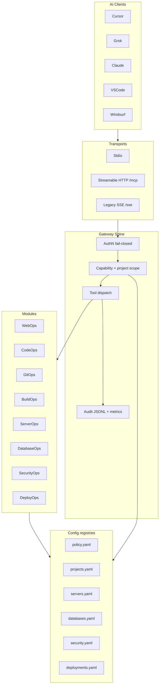

# Universal MCP Platform Architecture

## Overview

`global-server-mcp` is a **policy-gated MCP gateway**. AI clients connect via stdio or HTTP; every tool call passes AuthN → AuthZ → audit. Adapters execute work; security decisions stay in the gateway.

## Design rules

1. **Default deny** — no host/capability/path/project → deny
2. **Thin adapters** — no duplicated authz/approval engines inside adapters
3. **Config-driven projects** — add a project via `config/projects.yaml` (+ related registries); do not edit gateway core
4. **Honest support status** — stack profiles mark `certified|supported|experimental|planned`
5. **Principal isolation** — sessions, build workspaces, browser contexts, credentials never shared across principals

## Module map

| Module | Prefix | Registry |
|---|---|---|
| WebOps | `http.*` `page.*` `session.*` | policy hosts |
| CodeOps | `code.*` | allow_paths |
| GitOps | `git.*` | github_repos |
| BuildOps | `build.*` | project.build |
| ServerOps | `server.*` | servers.yaml |
| DatabaseOps | `db.*` | databases.yaml |
| SecurityOps | `security.*` | security.yaml |
| DeployOps | `deploy.*` | deployments.yaml |
| Platform | `platform.*` | projects.yaml / stack-profiles.yaml |

## Extending

- **New project:** edit `config/projects.yaml` + link servers/db/security/deploy ids
- **New adapter capability:** types → definitions → `requireCap` in gateway → policy allowlist → audit
- **New module metadata:** `registerModule()` in `src/platform/modules.ts`

See also: [clients](./clients/), [onboarding](./onboarding/), [SECURITY.md](./SECURITY.md).
